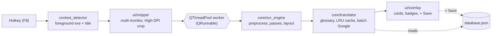

<div align="center">

# Contextual UI Screen Translator

**Press a hotkey, drag over any text on screen, and get a translation that knows *which application* you are looking at.**
Adaptive computer-vision OCR · context-weighted glossary · non-blocking hybrid translation

Python · PyQt5 · Tesseract OCR · Win32 API (ctypes)

[](https://www.python.org/)
[](https://pypi.org/project/PyQt5/)
[](https://github.com/UB-Mannheim/tesseract/wiki)
[](#8-installation)
[](#7-testing)
[](./LICENSE)

[Overview](#1-overview) · [Architecture](#3-architecture) · [Technical highlights](#4-technical-highlights) · [Evaluation](#6-experimental-evaluation) · [Install](#8-installation) · [Limitations](#11-limitations)

</div>

---

## 1. Overview

Screen Translator is a tray application. Press **F8**, drag a rectangle over text anywhere (an IDE, a browser menu, a game, a PDF) and a floating window shows every recognised block with its translation.

It started as a single-file prototype (`snipping_tool.py`). This version is a modular rewrite that turns "OCR + translate" into a system with three ideas behind it:

1. **Context.** The app reads which program is in the foreground (`Code.exe`, `chrome.exe`, `figma.exe` ...) and uses it to disambiguate terminology. *Branch* is a Git branch in an IDE and a company branch in an office document, so the glossary returns a different translation for each.
2. **Adaptive vision.** Dark-mode UIs are detected from luminance and inverted, small captures are upscaled, passes are chosen from an estimated line count and the winner is picked by confidence-weighted coverage, not by "first non-empty output".
3. **Structure-aware text.** Word bounding boxes are rebuilt into lines, menu items keep their shortcuts, and wrapped sentences are merged into paragraphs so Google Translate sees a complete sentence.

### What changed from the prototype

| Area | Prototype | This version |
| :-- | :-- | :-- |
| Context | per-line `fuzz.ratio` only | foreground process detection, +10 / -10 context scoring, paragraph merging |
| Architecture | one 600+ line file | `core/` (Qt-free engine), `ui/`, `tests/`, `scripts/` |
| OCR | PSM 6 -> 7 -> 11, first non-empty wins | dark-mode inversion, adaptive scale, line-count-driven passes, confidence-weighted selection |
| Concurrency | OCR + HTTP on the GUI thread | `QThreadPool` / `QRunnable`, batched requests, LRU cache, timeout |
| Offline | silently returned the source text | explicit `Offline / Error` badge; glossary still works |
| UX | hard-coded Tesseract path, primary monitor, language reset on every scan | auto-discovery, settings dialog, multi-monitor + High-DPI, persistent `config.json`, `+ Save` to glossary |
| Evidence | none | 125 unit tests and a reproducible CER / WER / latency benchmark |

---

## 2. Features

| Feature | Description |
| :-- | :-- |
| **Global hotkey** | `F8` by default (configurable). Registration errors are reported in a tray balloon instead of crashing. |
| **Application context** | Foreground executable + window title via `ctypes`, mapped to `browser / ide / design / office / gaming / general`. |
| **Context-weighted glossary** | `database.json` entries may carry `"context"`. Matching domain +10, conflicting domain -10. 100 % backward compatible. |
| **Dark-mode handling** | Mean luminance < 110 -> automatic inversion so Tesseract always sees dark text on light paper. |
| **Confidence-scored multi-pass OCR** | `image_to_data` per pass; best pass chosen by confidence-weighted character mass. |
| **Layout grouping** | Wrapped lines become one paragraph; menu items, code lines and `item ... Ctrl+T` rows stay separate. |
| **Non-blocking pipeline** | OCR and translation run in worker threads; the window shows a loading state immediately. |
| **Hybrid translation** | Glossary -> LRU cache -> one batched Google request (per-line fallback, circuit breaker, timeout). |
| **Source badges** | `Local DB • 96% • IDE`, `Google`, `Cached`, `Offline / Error` plus `Context: Chrome (Browser)`. |
| **`+ Save`** | One click stores a Google translation in the glossary (tagged with the current app domain). |
| **Multi-monitor + High-DPI** | Captures every monitor; the crop is taken from the physical-resolution grab of the monitor holding the selection. |
| **Persistent settings** | `config.json` (auto-created) and a Settings dialog: hotkey, Tesseract path, OCR packs, grouping, dark-mode inversion. |
| **History** | Last 100 translations, searchable, with source and context. |
| **Pinyin** | Shown for Chinese text when the glossary entry has a `pinyin` field. |

Target languages: English · Vietnamese · Chinese (Simplified / Traditional) · Japanese · Korean · French · German · Spanish · Russian · Thai.

---

## 3. Architecture



```text
contextual-ui-translator/
├── main.py                     # entry point: single instance, tray, hotkey, --check diagnosis
├── config.py                   # config.json manager + Tesseract auto-discovery
├── core/                       # Qt-free engine (unit-tested and benchmarked headlessly)
│   ├── context_detector.py     # foreground process/title (ctypes) -> domain
│   ├── ocr_engine.py           # preprocessing, multi-pass OCR, bounding-box layout
│   ├── glossary.py             # context-weighted fuzzy matching + persistence
│   ├── translator.py           # glossary -> LRU cache -> batched Google, offline handling
│   ├── text_utils.py           # CJK spacing, shortcut parsing/repair, language guess
│   ├── metrics.py              # CER / WER
│   ├── history.py              # last-100 history store
│   └── languages.py            # supported languages + typed-name resolution
├── ui/
│   ├── snipper.py              # multi-monitor, High-DPI region selector
│   ├── overlay.py              # result cards, badges, loading state, history view
│   ├── workers.py              # QRunnable pipeline job + signals
│   ├── settings_dialog.py      # settings GUI
│   ├── services.py / styles.py
├── tests/                      # pytest-compatible unit tests (125)
├── scripts/benchmark.py        # CER / WER / latency benchmark
├── docs/                       # benchmark results, manual QA checklist
├── database.json               # glossary (32 entries, optional "context" field)
└── requirements.txt
```

**Design principles**

- **Separation of concerns.** `core/` imports nothing from Qt, so the whole decision logic runs in CI-style tests and in the benchmark without a display. `ui/` is a thin layer on top.
- **Dependency injection.** `HybridTranslator` takes its network backend as a callable; tests use a fake backend to simulate batching, mismatches, timeouts and outages deterministically.
- **Fail visibly.** Network errors, a missing Tesseract and an unregisterable hotkey each produce a specific message; none is hidden behind a plausible-looking result.

---

## 4. Technical highlights

### 4.1 Context-awareness

`core/context_detector.py` calls `GetForegroundWindow`, `GetWindowThreadProcessId` and `QueryFullProcessImageNameW` through `ctypes` (no extra dependency) **before** the snipping overlay appears, then maps the executable to a domain. Window-title hints cover host processes such as `ApplicationFrameHost.exe`.

`core/glossary.py` scores matches with fuzzy similarity and adjusts by context:

| Situation | Adjustment |
| :-- | :-- |
| entry `context` contains the active domain | **+10** (capped at 100) |
| entry targets other domains only | **-10** |
| entry is `global` / has no `context` / active domain is `general` | 0 |

A boost can only *re-rank* candidates: an entry must reach the similarity threshold (80) on text alone, so context never invents a match; a penalty can reject a borderline one.

```json
{
  "UI_015": { "en": "Branch", "vi": "Nhánh mã nguồn", "context": "ide" },
  "UI_016": { "en": "Branch", "vi": "Chi nhánh",       "context": "office" },
  "UI_010": { "en": "Extensions", "vi": "Tiện ích mở rộng", "context": ["browser", "ide"] }
}
```

### 4.2 Adaptive computer vision (`core/ocr_engine.py`)

1. **Dark-mode inversion.** Mean luminance of the grayscale capture < 110 -> invert.
2. **Adaptive upscaling.** 3x for strips shorter than 48 px, 2x for small captures, 1x for large ones.
3. **Contrast normalisation + Otsu.** If the 0.2-99.8 percentile spread is below 90, autocontrast and an Otsu threshold (pure NumPy) are applied. (Percentiles are deliberately robust to sparse text.)
4. **Projection-profile line counting.** The number of text rows decides which Tesseract modes run: single line -> PSM 7 + 6, several lines -> PSM 6 + 11.
5. **Fast path.** A first pass with mean confidence >= 88 is accepted immediately; otherwise the remaining pass runs and the winner is chosen by *confidence-weighted character mass* `sum(len(word) * (conf - 35) / 65)`. Mean confidence alone rewards a pass that reads *less* (one confident word beats six slightly less confident ones).
6. **Line-level gating.** Weak tokens are kept when their line holds a confident word (e.g. the mangled `Ctri+J` next to `Downloads`); a line of only weak tokens must still spell at least 4 letters/digits (so `main.py`, which Tesseract reads at ~0 confidence in monospace fonts, survives while 1-3 character icon noise does not).
7. **Gap-aware joining.** A space is inserted only if the pixel gap resembles one, fixing `glossary. lookup`.
8. **UI-specific repair.** `Ctri+ Shift+ Del` -> `Ctrl+Shift+Del`; prose such as "hold shift + click" is left untouched.

### 4.3 Layout grouping

From word boxes the pipeline rebuilds lines, splits rows at very wide gaps (label ... value) while keeping a right-aligned shortcut attached to its label, then merges consecutive lines into a paragraph only if **all** hold: no trailing shortcut/ellipsis, not code-like, same font size, aligned left or centred, vertical gap within 0.55 line heights (0.9 if the next line clearly continues the sentence), and the previous line spans most of the block width. Results: a wrapped paragraph translates as one sentence, a menu stays one card per item.

### 4.4 Hybrid translation (`core/translator.py`)

`glossary -> LRU cache -> batch`. Uncached lines are joined into **one** request (split on newline, verified by count, per-line fallback otherwise). A circuit breaker limits a dead network to two failed calls, every call has a hard timeout, errors are never cached, and failures are reported as `Offline / Error` rather than disguised as translations. Glossary hits re-attach the original shortcut and ellipsis (`In…  (Ctrl+P)`).

### 4.5 UI correctness fixes

- The language box no longer reacts to every keystroke; only a confirmed choice (pick, Enter, focus-out) triggers a translation, and partial text never reaches the network or `history.json`.
- Returning from the History view neither re-translates nor writes a duplicate history entry.
- The captured image is processed in memory; no `capture.png` is written.

---

## 5. Usage

1. Press **`F8`** (or tray -> *Capture Screen to Translate*), drag over text, `Esc` / right-click cancels.
2. Pick a target language (type to filter, press Enter).
3. **Copy** the original or translation; **+ Save** adds a Google result to the glossary.
4. **History** shows the last 100 translations.

`python main.py --check` prints an environment diagnosis (missing packages, Tesseract path and packs, glossary, config).

---

## 6. Experimental evaluation

`scripts/benchmark.py` renders reproducible synthetic UI screenshots and compares three methods:

- **Raw Tesseract**: `image_to_string` with default settings.
- **Prototype pipeline**: the original app's OCR step (2x upscale + padding, PSM 6 -> 7 -> 11, first non-empty wins), re-implemented faithfully.
- **Adaptive pipeline**: this project.

```bash
python scripts/benchmark.py --samples 20 --seed 7 --output docs/benchmark_results.md
```

#### Experimental setup

- Date: 2026-11-24
- Platform: Linux 6.18.44-fc-v819, Python 3.12.3, Pillow 13.0.0
- Tesseract 5.3.4, OCR languages: `eng`
- Images: synthetic anti-aliased renders (not real screenshots)
- CJK case skipped (needs the `chi_sim` Tesseract pack and a CJK font)

#### OCR accuracy and latency

| Case | Method | CER | WER | Latency (ms, median) |
| :-- | :-- | --: | --: | --: |
| Light-mode menu + shortcuts (12-14 px) | Raw Tesseract | 23.9% | 24.7% | 156 |
| Light-mode menu + shortcuts (12-14 px) | Prototype pipeline | 1.1% | 6.4% | 211 |
| Light-mode menu + shortcuts (12-14 px) | Adaptive pipeline | 0.0% | 0.4% | 287 |
| Dark-mode menu + shortcuts (12-14 px) | Raw Tesseract | 28.4% | 33.7% | 255 |
| Dark-mode menu + shortcuts (12-14 px) | Prototype pipeline | 1.4% | 8.8% | 386 |
| Dark-mode menu + shortcuts (12-14 px) | Adaptive pipeline | 0.1% | 0.6% | 361 |
| Dark-mode IDE labels / code (monospace) | Raw Tesseract | 1.7% | 14.4% | 259 |
| Dark-mode IDE labels / code (monospace) | Prototype pipeline | 0.8% | 10.5% | 388 |
| Dark-mode IDE labels / code (monospace) | Adaptive pipeline | 0.7% | 10.0% | 281 |
| Small 10 px paragraph (3-4 lines) | Raw Tesseract | 1.2% | 7.0% | 146 |
| Small 10 px paragraph (3-4 lines) | Prototype pipeline | 0.0% | 0.0% | 216 |
| Small 10 px paragraph (3-4 lines) | Adaptive pipeline | 0.0% | 0.0% | 218 |
| 14 px wrapped paragraph, light + dark | Raw Tesseract | 0.2% | 0.8% | 190 |
| 14 px wrapped paragraph, light + dark | Prototype pipeline | 0.0% | 0.0% | 293 |
| 14 px wrapped paragraph, light + dark | Adaptive pipeline | 0.0% | 0.0% | 222 |

#### Summary (mean over cases)

| Subset | Method | CER | WER | Latency (ms) |
| :-- | :-- | --: | --: | --: |
| All cases | Raw Tesseract | 11.1% | 16.1% | 201 |
| All cases | Prototype pipeline | 0.7% | 5.1% | 299 |
| All cases | Adaptive pipeline | 0.2% | 2.2% | 274 |
| All cases | **Error reduction of adaptive vs raw / vs prototype** | 98% / 73% | 86% / 57% | |
| Dark-mode cases | Raw Tesseract | 15.0% | 24.0% | 257 |
| Dark-mode cases | Prototype pipeline | 1.1% | 9.7% | 387 |
| Dark-mode cases | Adaptive pipeline | 0.4% | 5.3% | 321 |
| Dark-mode cases | **Error reduction of adaptive vs raw / vs prototype** | 97% / 62% | 78% / 45% | |

#### Structure: output blocks == expected blocks

Menus should come out as one block per item (shortcut attached); a wrapped paragraph as one block.

| Case | Raw | Prototype | Adaptive |
| :-- | --: | --: | --: |
| Light-mode menu + shortcuts (12-14 px) | 45.0% | 100.0% | 100.0% |
| Dark-mode menu + shortcuts (12-14 px) | 40.0% | 100.0% | 100.0% |
| Dark-mode IDE labels / code (monospace) | 100.0% | 100.0% | 90.0% |
| Small 10 px paragraph (3-4 lines) | 0.0% | 0.0% | 100.0% |
| 14 px wrapped paragraph, light + dark | 0.0% | 0.0% | 100.0% |

_20 generated samples per case, seed 7. Error reduction = (old - new) / old; negative means the adaptive pipeline is worse._

### How to read these numbers

- **Synthetic data.** Images are clean anti-aliased renders with DejaVu fonts, not real screenshots, so absolute numbers will differ on your machine and on real UIs. Re-run the script on your own fonts before quoting figures.
- **English only.** The run used the `eng` pack; the CJK case runs automatically when `chi_sim` and a CJK font are installed and was skipped here.
- **Latency** was measured on a single-core Linux sandbox, where the two pipelines are comparable (the adaptive one skips its second pass whenever the first is confident). Windows numbers were not measured.
- **Development protocol.** Thresholds (`KEEP_WORD_CONF`, fast-path confidence) were tuned on a separate `tune` seed; some failure analysis used seed 42. The table above uses **seed 7, which was not used during development**. Expect a smaller gain on data that differs from the generator (shortcut repair in particular helps most on menus with `Ctrl+...` labels).
- **Where the adaptive pipeline is not better.** On the monospace IDE case its CER/WER are essentially equal to the prototype's and its block segmentation is slightly worse (see the tables above): code lines are the hardest layout to group.

---

## 7. Testing

```bash
pip install -r requirements-dev.txt
pytest -v
```

125 tests cover glossary scoring (shortcut stripping, CJK normalisation, context boost/penalty), OCR preprocessing and geometry (synthetic PIL images, bounding-box fixtures, mocked Tesseract), the translator (routing, caching, batching, offline handling, timeouts), configuration and context mapping. A few integration tests use the real Tesseract and are skipped automatically if it is not installed.

The Qt layer, hotkey and Win32 calls need a real desktop; verify them with [`docs/MANUAL_QA.md`](docs/MANUAL_QA.md).

---

## 8. Installation

**1. Tesseract OCR** (UB Mannheim build on Windows): <https://github.com/UB-Mannheim/tesseract/wiki>. Tick the language data you need; supported packs:

```text
eng  vie  chi_sim  chi_tra  jpn  kor  fra  deu  rus  spa  tha
```

The app finds `tesseract.exe` via `PATH`, the standard `Program Files` folders or the path set in Settings; it never crashes on a hard-coded path.

**2. Clone and run**

```bash
git clone https://github.com/lenghiemgiaphu/UI_Screen_Translator_Tool.git
cd UI_Screen_Translator_Tool
python -m venv venv
venv\Scripts\activate
pip install -r requirements.txt
python main.py --check      # optional diagnosis
python main.py
```

---

## 9. Configuration (`config.json`, auto-created)

| Key | Default | Meaning |
| :-- | :-- | :-- |
| `last_target_lang` | `"Vietnamese"` | remembered across restarts |
| `hotkey` | `"f8"` | any `keyboard` combination, e.g. `"ctrl+shift+t"` |
| `tesseract_path` | `""` | empty = auto-detect |
| `auto_group_paragraphs` | `true` | merge wrapped lines before translating |
| `dark_mode_auto_invert` | `true` | invert dark-mode captures |
| `ocr_languages` | `[]` | empty = every installed supported pack |

Invalid or hand-edited values fall back to the defaults.

---

## 10. Local glossary (`database.json`)

Every text value of an entry (except `pinyin` and `context`) is a searchable source term, and the entry must contain the target language code to be used. Input is NFKC-normalised, lower-cased, stripped of trailing shortcuts (`Ctrl+T`) and ellipses, then fuzzy-matched. The file is re-read when it changes, so edits apply on the next capture. The bundled Vietnamese terms are a starting point; review them before relying on them.

---

## 11. Limitations

1. **Windows-first.** Foreground detection uses Win32; on other systems the context is always `general`. The `keyboard` hook may need elevated rights to reach elevated windows.
2. **Selections spanning two monitors** are cropped from the monitor holding most of the selection.
3. **OCR quality varies** for stylised, rotated or very low-contrast text; CJK accuracy depends on the installed Tesseract packs.
4. **Google Translate** via `deep-translator` is an unofficial endpoint (internet needed, may be rate-limited). Glossary hits work offline.
5. **Evaluation is synthetic** (see section 6); no real-screenshot dataset is included.
6. **Hotkey conflicts.** The `keyboard` library observes keys rather than reserving them, so another app that also uses the same key still fires.

**Roadmap:** real-screenshot benchmark set, optional offline translation backend, packaged `.exe` installer, cross-platform context detection.

---

## 12. Privacy

Screenshots are processed locally by Tesseract and never written to disk. Only the text of lines not resolved by the glossary is sent to Google Translate. History, config and glossary are plain JSON files next to the app; *Clear All* deletes the history.

---

## 13. License

MIT, see [`LICENSE`](./LICENSE).
